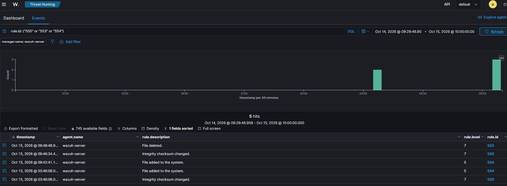

# Linux File Integrity Monitoring (FIM) Investigation

## 1. Investigation Objective

Investigate file creation, modification, and deletion events on a Linux system using Wazuh File Integrity Monitoring (FIM).

## 2. Lab Environment

- SIEM: Wazuh 4.14.8
- Operating System: Ubuntu 24.04
- Monitored Endpoint: wazuh-server
- Monitoring Component: Wazuh Syscheck (FIM)

## 3. Investigation Scenario

Controlled file operations were performed in the SOC lab to observe how Wazuh detects changes to monitored files.

The investigation focused on three activities:

- File creation
- File modification
- File deletion

## 4. Detection and Findings

| Wazuh Rule | Activity | Description |
|---|---|---|
| 554 | File Added | A monitored file was created |
| 550 | File Modified | A monitored file was changed |
| 553 | File Deleted | A monitored file was removed |

## 5. SOC Analyst Investigation

The investigation focused on:

- Identifying the affected file paths
- Reviewing timestamps and alert descriptions
- Understanding the type of file operation
- Correlating related file changes
- Assessing whether the activity was authorized

### Assessment

Classification: Controlled file integrity testing

Disposition: Expected / Benign activity

These events were generated during authorized lab testing. However, unexpected changes to sensitive files may indicate unauthorized modifications or attempts to conceal malicious activity.

## 6. Evidence

### JSON Alert Evidence

- [File Added — Rule 554](evidence/linux-fim-file-added-554.json)
- [File Modified — Rule 550](evidence/linux-fim-file-modified-550.json)
- [File Deleted — Rule 553](evidence/linux-fim-file-deleted-553.json)

## 7. Key Learning Outcomes

- Investigated Linux file integrity events
- Identified Wazuh Rules 554, 550, and 553
- Understood file creation, modification, and deletion monitoring
- Practiced reviewing file integrity alerts
- Documented SOC investigation findings

## 8. Conclusion

Wazuh File Integrity Monitoring detected file changes during controlled testing.

This investigation demonstrates how FIM provides visibility into file system activity and supports the detection of potentially unauthorized changes.
